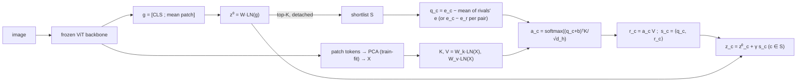

# Design document — Rival-Conditioned Evidence Attention (RCEA)

Status: design frozen on 2026-11-08 before any test-split evaluation. Every number in this file is either a
property of the code (parameter counts, operation counts, verified by running it) or a citation; no
experimental result is quoted here. Results live in `results/` and in the paper.

Companion files: the literature and novelty dossier `research_log/lit_core.md` (Part 3 is the novelty gate),
the related-work table `results/literature_table.csv`, the implementation `src/dogbreed/modules/rival_attention.py`
and `src/dogbreed/models/heads.py`, and the tests `tests/test_rival_attention.py`.

---

## 1. The problem the method targets

Dog-breed recognition fails in a specific way. A strong global descriptor usually puts the right breed among its
top few guesses, and the remaining error is concentrated in small, image-specific sets of look-alike breeds
(Norfolk vs Norwich terrier: ear carriage; Siberian husky vs Alaskan malamute: size and face mask; the toy
poodle / miniature poodle / standard poodle triple: size cues that a crop removes). Which local evidence
decides the case depends on *which* breeds are being confused in *this* image. A classifier that pools the
patches once, the same way for every class (mean pooling, or a fixed set of attention queries), cannot use
that.

The design question is therefore: given frozen patch tokens and a global classifier that is already good at
shortlisting, can a small head that looks again at the patches, *conditioned on the image's own shortlist*,
fix the residual confusions, and can we show that the conditioning, not extra capacity, is what helps?

---

## 2. Candidate architectures considered (design-stage comparison; only A was built and trained)

| | Candidate | Core idea | Closest prior work (dossier) | Novelty risk | Cost on one free T4 | Can a cheap control falsify it? | Decision |
|---|---|---|---|---|---|---|---|
| **A** | **Rival-conditioned evidence attention (RCEA)** | Global head → top-K shortlist → each candidate attends to the patches with a query built *against the other candidates* → per-candidate score added to its logit | CSRA (mechanism) [zhu2021csra], SAC (pipeline) [do2024sac], FuDD (idea) [esfandiarpoor2024fudd]; contrasts as in CLRP / SGLRP [gu2018clrp, iwana2019sglrp] | Medium: every ingredient exists, the combination does not (verdict in `lit_core.md` §3.5) | Head only, on cached frozen tokens: minutes per run | **Yes**: the query is the only thing that changes between `class`, `center`, `random` and `rival`, at identical parameter count | **Selected** |
| B | Slot-based part discovery + relation transformer | Unsupervised part slots, then a transformer over part relations | Relational Proxies [chaudhuri2022relational], PDiscoNet [vanderklis2023pdisconet] | High: the idea space is well covered | End-to-end training of the backbone or the slots: hours per run | Weakly: "parts help" has no clean single-variable control | Rejected |
| C | Confusion-graph adaptive margins + uncertainty-gated local refinement | A class-confusion graph sets per-pair margins in the loss; uncertain images get a second local look | Pairwise Confusion [dubey2018pc], Maximum-Entropy FGVC [dubey2018maxent], HD-CNN [yan2015hdcnn], Seesaw [wang2021seesaw]; gating as in GFNet / AdaFocus [wang2020gfnet, wang2021adafocus] | Medium–high: two known parts | Moderate | Partly: margins and gating confound each other | Rejected (its "second look only where uncertain" idea survives inside A as the shortlist) |
| D | Head–body box-distilled attention | Tsinghua's head/body boxes supervise the attention at training time only | Head-Body Guided framework [khan2025headbody]; attention supervision | Medium | Low | Yes | Kept as a possible auxiliary, not the contribution: it needs part boxes, which Stanford Dogs lacks (no head boxes) |

Selection criteria, in order: (1) a contribution that survives the novelty gate; (2) a single-variable control
that can refute it; (3) affordable on the compute actually available (one free-tier T4, 2 vCPU, 12 GB RAM);
(4) no use of annotations at test time (fully automatic inference). Only A meets all four.

---

## 3. The mechanism

### 3.1 Notation

| Symbol | Meaning | Value in the main study |
|---|---|---|
| X = [x_1 … x_N], x_i ∈ R^D | frozen backbone patch tokens (registers dropped), projected on the first D principal components of the training tokens | N = 256 (16 × 16 grid at 224 px, patch 14), D = 128 of a 256-component PCA fitted on 4,000 *training* images |
| g ∈ R^{D_g} | global descriptor [CLS ; mean patch] (DINOv2 linear-evaluation recipe) | D_g = 1536 |
| C | number of breeds | 130 (Tsinghua Dogs), 120 (Stanford Dogs) |
| z⁰ = W LN(g) + b | stage-1 global logits | |
| S = top-K(z⁰) | the image's shortlist (candidate set) | K = 5 |
| e_c ∈ R^d | learned class embedding (untied from W) | d = 256 |
| H, d_h = d/H | attention heads and head width | H = 4, d_h = 64 |
| W_k, W_v ∈ R^{d×D} | key / value projections of LN(x_i), shared by all queries | |
| b ∈ R^d | one class-agnostic attention bias ("look at the dog") | |
| γ | learned scale of the second-stage score | initialised to 1 |
| τ | attention temperature | 1 |

### 3.2 Stage 1 and the shortlist

z⁰ = W LN(g) + b. The shortlist S = top-K(z⁰) is taken **without gradient** (the re-ranker cannot move
candidates in or out of its own shortlist). During training only, if the true class y is not in S it replaces
the weakest candidate (`gt_insert`), so the second stage always learns to separate the truth from its hardest
rivals. At test time S is purely the top-K of z⁰: inference is fully automatic, one image at a time, with no
batch statistics.

### 3.3 Queries

For each candidate c ∈ S the query is built from the class embeddings of the shortlist:

- `rival` (proposed): q_c = e_c − (1/(K−1)) Σ_{r∈S, r≠c} e_r                                            (1)
- `rival_soft` (proposed): q_c = e_c − Σ_{r≠c} w_{c,r} e_r with w_{c,·} = softmax over the rivals of the
  *detached* global logits z⁰_r / T                                                                       (1s)
- `pairwise` (proposed): one query per ordered pair, q_{c,r} = e_c − e_r for every r ∈ S, r ≠ c             (1')

Controls (identical parameters; only the query changes):

- `class`: q_c = e_c (class-specific query; CSRA's form restricted to the shortlist)
- `center`: q_c = e_c − (1/C) Σ_{j=1..C} e_j (global centring; the CLRP-1 contrast)
- `random`: q_c = e_c − mean of K−1 random classes ≠ c, redrawn every forward pass (contrast, but not with the
  image's confusion set)

### 3.4 Evidence attention and score

    a_{c,i} = softmax_i( (q_c + b)ᵀ W_k LN(x_i) / (√d_h · τ) )        per head                          (2)
    r_c     = Σ_i a_{c,i} W_v LN(x_i)                                                                     (3)
    s_c     = ⟨q_c, r_c⟩ / √d_h                                        summed over the H heads            (4)

The pooled evidence is scored along the *same* direction that selected it. Final logits:

    z_c = z⁰_c + γ s_c   for c ∈ S,        z_c = z⁰_c   otherwise.                                        (5)

For `pairwise`, (2)–(4) run once per pair, giving s_{c,r} (each pair has its own attention map), and the
candidate keeps its evidence against its strongest rival through a soft minimum:

    s_c = softmin_t over r of s_{c,r} = −t · log( (1/(K−1)) Σ_{r≠c} exp(−s_{c,r}/t) )                      (4')

t → 0 gives the minimum; t → ∞ the mean over rivals; t = 1 in the main study (`pair_temp`).

### 3.5 Training objective

L = CE_ls(z, y) + α · CE_ls(z⁰, y), label smoothing 0.1, α = 1 (`aux_global`), AdamW (weight decay 0.05 on
matrices only), one warm-up epoch then cosine decay, batch 256, at most 30 epochs, early stopping on
validation top-1 (patience 8), gradient clipping at 1. Regularisation: 10 % of the tokens dropped at random per
training image (`token_drop`); each training image uses its cached original or horizontally flipped view at
random. An ablation replaces the first term by a softmax over the shortlist only (`loss: candidate`).

---

## 4. Four facts that shape the claim (derived here; the proofs are short)

**Fact 1 — uniform rivals are shortlist centring.** With ē_S = (1/K) Σ_{j∈S} e_j,

    q_c = e_c − (1/(K−1)) (K ē_S − e_c) = (K/(K−1)) (e_c − ē_S).

So `rival` = "centre the class embeddings on the image's own shortlist" (the factor K/(K−1) is absorbed by the
learned embeddings). The K queries sum to zero; for K = 2 they are exact negatives, q_1 = e_1 − e_2 = −q_2.
Consequence: the four controls form one axis — no centring (`class`), centring on all classes (`center`),
centring on a random set (`random`), centring on the image's shortlist (`rival`) — and the honest statement of
the contribution is **where the centring set comes from**. A gain of `rival` over `center` and `random` at equal
parameters is evidence for shortlist conditioning; a gain over `class` alone is not.

**Fact 2 — probability-weighted rivals are a log-softmax gradient when the weights are tied.** If e_j were the
global classifier's weights w_j acting on a pooled feature f, with p the softmax over S and
π_r = p_r/(1 − p_c), then ∇_f log p_c = w_c − Σ_{j∈S} p_j w_j = (1 − p_c)(w_c − Σ_{r≠c} π_r w_r). So `rival_soft`
with tied weights and identity projections would be a Grad-CAM-of-log-softmax map restricted to the shortlist
(SGLRP's weighting [iwana2019sglrp]), computable after training. This is why e_c is **untied** from W and W_k,
W_v are learned, and why π uses the *detached* z⁰ (the second stage cannot reshape the first stage's
probabilities to suit itself).

**Fact 3 — what the score measures.** With identity projections and no bias, s_c = Σ_i softmax_i(⟨q_c, x_i⟩/τ) ⟨q_c, x_i⟩:
a soft maximum over patches of c's per-patch margin over its rivals (CSRA's average-plus-max form [zhu2021csra]
with the class weight replaced by the contrastive query; τ → 0 gives the hard max).

**Fact 4 — `pairwise` is not reducible to a centred query, and equals `rival` at K = 2.** For K = 2,
S = {c, r} and q_{c,r} = e_c − e_r is the `rival` query; the soft minimum over one rival is the identity, so the
two modes coincide exactly (asserted numerically in `tests/test_rival_attention.py`). For K ≥ 3 the K − 1 pair
queries of one candidate are different vectors, each with its own softmax attention map, and (4') aggregates
the K − 1 pooled scores non-linearly. A single query per candidate cannot reproduce K − 1 different attention
maps (softmax attention is not linear in the query), so no choice of centring set gives the same function. It is
the learned, visual counterpart of FuDD's pairwise descriptions [esfandiarpoor2024fudd] and POOF's pair-specific
features [berg2013poof], formed per image instead of for all pairs.

---

## 5. Diagram

```
  image ──► frozen DINOv2 ViT-B/14-reg ──► CLS, 256 patch tokens (768-d)
                                     │                      │
                     g = [CLS ; mean patch] (1536)      PCA (fit on train) → X ∈ R^{256×128}
                                     │                      │
                       z⁰ = W·LN(g) + b  ─── top-K (no grad) ──► S = {c₁ … c_K}
                                     │                      │
                                     │      queries from S: q_c = e_c − mean_{r∈S∖c} e_r    (rival)
                                     │                       or q_{c,r} = e_c − e_r         (pairwise)
                                     │                      │
                                     │      K, V = W_k·LN(X), W_v·LN(X)  (shared, computed once)
                                     │      a_c = softmax((q_c + b)·K / √d_h)  →  r_c = a_c·V
                                     │      s_c = ⟨q_c, r_c⟩/√d_h      (pairwise: soft-min over rivals)
                                     ▼                      │
                 z_c = z⁰_c + γ·s_c  for c ∈ S,   z_c = z⁰_c otherwise  ◄───┘
```



---

## 6. Pseudocode (one batch; matches `CandidateReRanker.forward`)

```
input : g (B, Dg), X (B, N, D), labels y (training only)
z0   = W @ LN(g) + b                                   # (B, C)
S    = topk(z0.detach(), K)                            # (B, K) indices
if training and gt_insert: S[y ∉ S, -1] = y            # truth replaces the weakest candidate
E    = class_emb[S]                                    # (B, K, d)
if mode == "pairwise":
    Q = E[:, :, None] - E[:, rival_index(K)]           # (B, K, K-1, d)  q_{c,r} = e_c - e_r
    Q = Q.reshape(B, K*(K-1), d)
else:
    Q = make_query(E, mode)                            # rival: E - (E.sum(1) - E)/(K-1); class: E; ...
Kt, Vt = split_heads(W_k @ LN(X)), split_heads(W_v @ LN(X))      # (B, H, N, d_h), once per image
A    = softmax(split_heads(Q + bias) @ Kt^T / (sqrt(d_h)*tau))   # (B, H, Q, N); token_drop masks keys
Rv   = A @ Vt                                          # (B, H, Q, d_h)
s    = sum_heads(sum_d(split_heads(Q) * Rv)) / sqrt(d_h)         # (B, Q)
if mode == "pairwise": s = softmin_t(s.view(B, K, K-1))           # (B, K)
z    = z0.scatter_add(1, S, gamma * s)                 # only the K candidates move
loss = CE_ls(z, y) + aux * CE_ls(z0, y)
```

---

## 7. Complexity (verified against the code)

Parameters (`count_params`, D_g = 1536, D = 128, d = 256, H = 4):

| Head | Tsinghua (C = 130) | Stanford (C = 120) | Formula |
|---|---|---|---|
| linear (B0) | 202,882 | 187,512 | 2D_g + (D_g+1)C |
| attnprobe (B1, M = 4 queries) | 404,866 | 379,256 | 2D + 2Dd + Md + 2D_g + 2Md + (D_g+Md+1)C |
| classattn_all (B2) | 302,211 | 284,281 | linear + Cd + 2D + 2Dd + d + 1 |
| rerank, every mode (proposed and controls) | 302,211 | 284,281 | identical to B2 |

All re-rank modes, including `pairwise`, have exactly the parameters of the all-class head B2, so every
comparison between them is at equal capacity.

Multiply–accumulates per image for the head (N = 256), ignoring LayerNorms and the softmax:

| Part | Cost | Main config |
|---|---|---|
| keys and values (shared) | 2·N·D·d | 16.8 M |
| global head | D_g·C | 0.20 M |
| attention + pooling + score, per query | 2·N·d + d | 0.131 M |
| queries: rerank K = 5 | K | 0.66 M |
| queries: pairwise K = 5 | K(K − 1) = 20 | 2.63 M |
| queries: all classes (B2) | C = 130 | 17.1 M |

Totals: rerank 17.6 M, pairwise 19.6 M, all-class 34.1 M MACs. For scale, the frozen ViT-B/14 at 224 px costs
about 23.5 G MACs (12 blocks × (12·n·768² + 2·n²·768) with n = 261 tokens, plus the patch embedding), so the
proposed head adds under 0.1 % to inference; the cached-feature protocol means it also trains in minutes.
Memory: the attention tensor is B·H·Q·N, i.e. linear in the number of queries; `pairwise` grows it by K − 1.
Measured FLOPs, latency and peak memory come from `src/dogbreed/evaluation/efficiency.py` and are reported in
the results, not here.

---

## 8. Falsifiable hypotheses and decision rules

Model selection (the learning rate of each head) uses the validation split only, on seed 0, by validation
top-1 (ties: lower NLL); seeds 0–2 are then trained at the chosen rate. The test splits are evaluated once,
after the selection is frozen and written to `research_log/research_log.md`. Primary metric: test top-1,
mean over 3 seeds. For each comparison: per-seed paired bootstrap (10,000 resamples of test images) of the
accuracy difference and the exact McNemar test; the claim "A > B" requires the difference to be positive in all
3 seeds and its 95 % bootstrap interval to exclude 0 in at least 2 of the 3.

| | Hypothesis | Prediction | Refuted if |
|---|---|---|---|
| H1 | Shortlist conditioning helps | `rival` (or `rival_soft` / `pairwise`) > `class`, `center` and `random` on Tsinghua test; same sign on Stanford test | the best proposed mode does not beat the best of the three controls by the rule above |
| H2 | It acts where it should | among images whose truth is in S but not top-1 under z⁰, fixes ≫ breaks; the gain over `linear` is concentrated in the most-confused breed pairs of the linear probe | fix rate ≤ break rate, or the gain on the 20 most-confused pairs is no larger than the overall gain |
| H3 | It is the confusion set, not contrast in general | `random` ≤ `center` (contrast with arbitrary classes does not carry the effect) | `random` ≈ `rival` (within the seed spread): the effect would be centring or regularisation |
| H4 | Pairwise evidence adds beyond centring | `pairwise` ≥ `rival` at K = 5 (identical at K = 2 by Fact 4) | exploratory; reported either way |
| H5 | The shortlist costs nothing | rerank ≥ all-class attention B2 at 1/26 of its query cost (K = 5 vs C = 130) | B2 is better by the rule above |
| H6 | K behaves like a shortlist | over K ∈ {2, 3, 5, 10}: shortlist recall rises with K and accuracy is flat or peaks at a small K | accuracy falls monotonically from K = 2 |
| H7 | Robustness (exploratory) | under corruptions that lower top-1 but keep top-K recall, the re-ranker recovers more than the linear head | reported either way |

The decision rule is applied to the numbers as they come out; a refuted hypothesis is reported as refuted.

---

## 9. What each comparison isolates

| Comparison | Isolates |
|---|---|
| rerank-`class` vs `linear` | a second look at the patches with class-specific queries (CSRA on the shortlist) |
| `center` vs `class` | centring alone (global, image-independent) |
| `random` vs `center` | contrast against a random set of classes |
| **`rival` vs `random`** | **contrast against the image's own confusion set (the claim)** |
| `rival_soft` vs `rival` | weighting rivals by the global head's belief |
| `pairwise` vs `rival` | pairwise evidence vs shortlist centring (K ≥ 3) |
| rerank vs `classattn_all` | shortlist vs all classes at equal parameters |
| rerank vs `attnprobe` | class-conditional vs class-agnostic attention at similar capacity |

---

## 10. Inherited vs new

Inherited: the frozen backbones and their weights (DINOv2 with registers [oquab2024dinov2, darcet2024registers],
CLIP [radford2021clip], ResNet-50 [he2016resnet], ConvNeXt-T [liu2022convnext]); the [CLS ; mean patch]
descriptor; the CSRA scoring form (attention pooled by a class query and re-scored along it, added to the
logit) [zhu2021csra]; top-K shortlisting and re-scoring (SAC, PCNN, Look and Think Twice
[do2024sac, nguyen2024pcnn, cao2015lookthink]); the contrast logic of CLRP and SGLRP [gu2018clrp, iwana2019sglrp].

New in this work: queries contrasted against the **image's own shortlist** (uniform or belief-weighted), the
**pairwise / soft-minimum** variant, and the set of equal-parameter controls that separates shortlist
conditioning from centring, contrast and capacity.

---

## 11. Threats to validity, stated in advance

- **Pretraining overlap.** Stanford Dogs is a subset of ImageNet-1k train [khosla2011stanforddogs,
  deng2009imagenet]; DINOv2's LVD-142M includes ImageNet-22k "as is" (14.2 M images, DINOv2 Table 15
  [oquab2024dinov2]), which contains the ImageNet images Stanford Dogs was drawn from; CLIP's data is not public. Absolute accuracies on Stanford Dogs are therefore optimistic for every method; comparisons between
  heads on the same frozen features are not affected by this in the same way, and supervised-ImageNet backbones
  are flagged in every table.
- **Cross-dataset overlap.** About 18,000 Tsinghua images come from Stanford Dogs [zou2020tsinghuadogs]; the
  cross-dataset audit (`scripts/cross_overlap.py`) lists them, and transfer results use a de-duplicated Stanford
  test list.
- **Within-dataset near-duplicates** between train and test were found and the train copies excluded (86
  Tsinghua, 73 Stanford images; `prepare_data.py` audit).
- **Frozen features only.** The study measures heads on frozen features; whether the effect survives end-to-end
  fine-tuning is not tested unless the compute allows it, and is listed as pending otherwise.
- **Three seeds** limit the power of across-seed tests; the per-image paired tests carry most of the evidence.
- **PCA on tokens** (128 of 256 components, fitted on training images only) is a compression choice shared by
  every token head; an ablation varies it.
